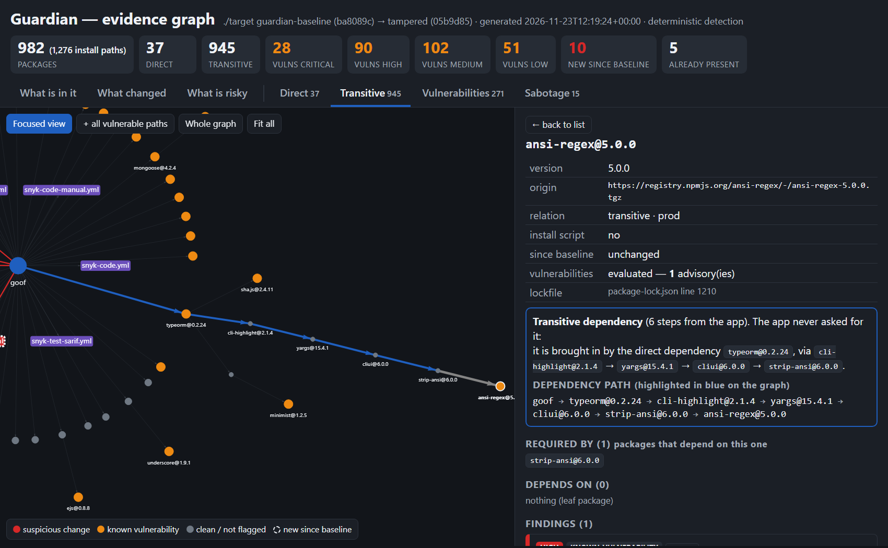

# Supply Chain Guardian

**Know what you build. Trust what you ship.**

Guardian compares a trusted version of an application with the version under review, finds known
vulnerabilities and supply-chain sabotage (look-alike packages, hijacked updates, loosened Docker
and CI settings), and backs every claim with the file, line, commit or API response that proves
it. It then ranks what matters for this application, proposes a fix that a **named human must
approve**, and proves the fix in a throwaway clone before reporting it. Facts, scores and pass/fail
are computed by code; AI agents only add labelled, evidence-checked inferences.

Built for the Bosch "Software Supply Chain Guardian" hackathon. Phase-by-phase build log with
measured results: [`implementations.md`](implementations.md).



---

## Status (honest, 2026-11-24)

| Capability | Status | Where |
|---|---|---|
| Inventory, CycloneDX SBOM (base + head + diff), dependency graph with paths | **works** | `fastpath/build.py` |
| Known vulnerabilities (OSV), CVE / severity / fix, path to the direct dependency | **works** | `fastpath/build.py` |
| Supply-chain sabotage rules (look-alike name, install script read statically, suspicious update, untrusted origin, unused import, Docker image, CI actions) | **works** — 7/7 planted findings, 3/3 negative controls | `fastpath/build.py` |
| Interactive dashboard (graph, direct / transitive / vulnerabilities / sabotage tabs, path tracing) | **works** | `fastpath/out/guardian.html` |
| Risk score 0–100 with range, confidence, guardrails; reachability R0–R3; EPSS + CISA KEV | **works** | `guardian/prioritise.py`, `scoring.py`, `reachability.py` |
| AI agents (Change Detective, Risk Analyst, Refuter, Remediation Planner, Diagnostician) | **built; live run not yet done** (no model key configured on the build machine) — offline fallback works | `guardian/agents/` |
| Fix candidates, dry runs, policy gate, plans with hash, human approval | **works** (approval unit-tested; no approval recorded on the demo run yet) | `guardian/remediate.py`, `policy.py` |
| Validation in a throwaway clone (apply, `npm ci --ignore-scripts`, static start, rescan, SBOM diff, new findings, policy) | **works up to the approval step** (machinery probed on an unmodified clone); container build and smoke test **not implemented**; no plan has been validated end to end yet (needs a human approval) | `guardian/validate.py` |
| Closed loop: failed validation → diagnosis → superseding plan → new approval | **built, unit-tested**; end-to-end run waits for a human approval | `guardian/loop.py` |
| Report: HTML, Markdown, schema-validated JSON, OpenVEX, before/after SBOMs | **works** | `guardian/report.py` |
| Hash-chained audit log | **works** | `guardian/audit.py` |
| Hold-out seeds, second application, NiceGUI UI, replay mode, Playwright UI test | **not built** | see [Known limitations](docs/KNOWN_LIMITATIONS.md) |

---

## Quick start

Prerequisites: Python ≥ 3.11.4 (3.12.1 tested), git, Node + npm (22 / 10 tested), Git Bash on
Windows. Optional: a Gemini API key (agents). Docker is not used: the container build and smoke
test of the validation design are not implemented.

```bash
# 0. build the demo target once (needs network; Windows notes in fastpath/README.md)
bash scripts/make_demo_target.sh

# Day 1: detect (about 20 s)
python -m guardian scan                       # runs the fast path, creates runs/<run_id>/
start fastpath/out/guardian.html              # the dashboard (macOS: open, Linux: xdg-open)

# Day 2: decide, fix, prove, report
python -m guardian prioritise                 # ranked list with scores
python -m guardian explain F162               # factor table for one finding
python -m guardian analyse                    # AI agents (needs GEMINI_API_KEY in .env; else "skipped")
python -m guardian plan --finding F359        # fix candidates, dry runs, policy gate -> prints the plan id (P-a)
python -m guardian approve P-a --approver "Your Name"
python -m guardian validate P-a               # on failure: diagnosis + superseding plan P-b (approve again)
python -m guardian report                     # runs/<run_id>/report/guardian-report.html
python -m guardian audit-verify
python -m guardian withdraw P-x --reason "..."      # make a pending plan unapprovable (e.g. a bad patch)
```

Finding ids depend on the run; use `python -m guardian prioritise` to see them.
**Offline mode:** add `--offline` to `scan` / `prioritise`, `--mode offline` to `analyse` / `plan`
/ `validate`, or set `GUARDIAN_OFFLINE=1`. Lookups are then served from `.cache/` or reported as
**not evaluated** (never as zero), agents are skipped, and npm dry runs use its cache only.
Tested in a fresh clone in a temporary folder (see implementations.md, phase 14).

**Model key:** put `GEMINI_API_KEY=...` in a `.env` file in this folder (git-ignored). It is read at
runtime and never printed. `python -m guardian doctor` reports whether it is present and which
configured models it can use.

---

## Demo scenario

1. **What is in it?** 982 packages (1,276 install paths), 37 direct; the graph traces any
   transitive package to the direct dependency that brings it in.
2. **What changed?** Four innocent-looking commits on `tampered`: a look-alike package with a
   secret-reading install script, a floating Docker base image, a third-party CI action on a
   mutable tag with `write-all` and `curl | bash`, and a patch release that adds a preinstall
   payload. All 7 planted findings are detected and linked to their commits.
3. **What matters?** lodash `merge` advisory: **R3** (the app calls `_.merge(…, req.body…)`),
   score 79, ranks above the higher-CVSS `defaultsDeep` advisory (72). Packages nothing loads
   are capped at 39. tj-actions' CVE-2025-30066 is in CISA KEV → 90.
4. **Fix it safely.** The ranked plan removes the look-alike package, its tarball and its unused
   `require()`; the manifest-only alternative is rejected because code would still require the
   package. A human approves the exact patch hash.
5. **Prove it** *(expected; not yet run end to end — it needs a human approval)*. Validation in a
   throwaway clone; the "manifest-only bot" plan (`plan --finding F359 --candidate C1`) should fail the static start check, the
   diagnosis should recommend the full removal, and the new plan needs a new approval.
6. **Report.** HTML / Markdown / JSON / VEX with the audit chain verified.

---

## Architecture

```mermaid
flowchart TB
    T[("<b>./target</b> git repo<br/>guardian-baseline → tampered<br/>read only")]
    EXT[("Public data (read only)<br/>OSV.dev · FIRST EPSS · CISA KEV<br/>npm registry (dry runs)")]
    LLM[("Gemini API<br/>redacted excerpts only")]

    subgraph D1["<b>DAY 1 · detect</b> · fastpath/build.py · built · deterministic"]
        direction LR
        X["<b>Extract</b><br/>git archive"] --> INV["<b>Inventory</b><br/>lockfile · Dockerfile<br/>workflows"]
        INV --> SB["<b>SBOM</b><br/>CycloneDX 1.5"]
        SB --> G["<b>Dependency graph</b><br/>Node.js resolution"]
        G --> V["<b>Vulnerabilities</b><br/>OSV"]
        G --> C["<b>Sabotage rules</b><br/>look-alike · install script<br/>update · origin · image · CI"]
    end

    subgraph D2["<b>DAY 2 · decide and fix</b> · guardian/ · built"]
        direction LR
        PRI["<b>Prioritise</b> (code)<br/>score · range · confidence<br/>reachability · EPSS · KEV"]
        AG["<b>AI agents</b><br/>Change Detective · Risk Analyst<br/>Refuter · Planner · Diagnostician<br/>read-only tools · INFERRED only"]
        PLN["<b>Plan</b> (code)<br/>candidates · dry run<br/>policy gate · plan hash"]
        HA{{"<b>HUMAN<br/>APPROVAL</b><br/>name + plan hash"}}
        VAL["<b>Validate</b> (code)<br/>throwaway clone · npm ci<br/>static start · rescan · SBOM diff"]
        DG["<b>Diagnose</b><br/>code + Diagnostician"]
        REP["<b>Report</b> (code)<br/>HTML · MD · JSON · VEX"]
        PRI --> AG --> PLN --> HA --> VAL --> REP
        VAL -. "fails" .-> DG -. "superseding plan" .-> HA
    end

    STORE[("<b>runs/&lt;id&gt;/</b> evidence store<br/>findings · evidence_index · plans<br/>approvals · validation · audit.jsonl (hash chain)")]

    T --> D1
    EXT --> D1
    D1 == "findings + evidence + graph" ==> D2
    EXT -.-> D2
    D2 <-. "agent calls only" .-> LLM
    D2 --> STORE

    classDef built fill:#e6f4ea,stroke:#1e8e3e,color:#0b3d1b
    classDef ai fill:#f3e8fd,stroke:#8430ce,stroke-dasharray:5 4,color:#3b0a6b
    classDef human fill:#fff4e5,stroke:#e8710a,stroke-width:3px,color:#5f2b00
    classDef data fill:#e8f0fe,stroke:#1a73e8,color:#0b2e6b
    class X,INV,SB,G,V,C,PRI,PLN,VAL,REP built
    class AG,DG ai
    class HA human
    class T,EXT,LLM,STORE data
    style D1 fill:#f8fdf9,stroke:#1e8e3e,stroke-width:2px
    style D2 fill:#f8fdf9,stroke:#1e8e3e,stroke-width:2px```

Agents never write facts, scores, plans or verdicts: their output is INFERRED and every quote is
checked against the evidence by code. The diagram's "Validate" box has no container build or smoke
test in this build (not implemented). Full design and what changed while building:
[`docs/ARCHITECTURE.md`](docs/ARCHITECTURE.md) (section 0 "As built"). Image for slides:
[`docs/architecture.png`](docs/architecture.png).

---

## Sample application and what we changed

[snyk-labs/nodejs-goof](https://github.com/snyk-labs/nodejs-goof), Apache-2.0, pinned to commit
`add14ba59e98240d9e00a235dd7d42cd61ae9912`: an Express + MongoDB app with a real dependency tree, a
Dockerfile, a compose file and CI workflows. `scripts/make_demo_target.sh` clones it into
`./target`, **removes the git remote** (nothing can be pushed), and adds:

| Change | Why |
|---|---|
| `guardian/smoke-test.sh` + `compose.guardian.yml` bound to 127.0.0.1 | credential-free build + HTTP check (upstream `npm test` needs a Snyk token; the app is deliberately vulnerable) |
| vendored `guardian-demo-strfmt@1.0.0` | a clean baseline version of the package that the "suspicious update" later replaces |
| tag `guardian-baseline` | the trusted version |
| branch `tampered`: 4 commits (look-alike `lodahs`, `FROM node:18`, risky workflow, `strfmt@1.0.1`) | simulated attacks; local `file:` tarballs only, nothing published; scripts only write a marker file |

What is planted and what must not be flagged: [`demo/ground_truth.yaml`](demo/ground_truth.yaml).
The rules are generic (a unit test fails if a seeded name appears in detector or planning code)
and work on any npm project with a `package-lock.json` v2/v3; other ecosystems are not implemented.

---

## Tools and data sources

| Item | Version (tested) | Purpose |
|---|---|---|
| Python (standard library) | 3.12.1 | everything in `fastpath/` and `guardian/` |
| jsonschema | 4.26.0 | validates the report JSON against `schemas/guardian-report.schema.json` |
| PyYAML, pytest | 6.0.3, 8.4.2 | tests only |
| git | 2.47.1 | `git archive`, `git log -S`, clones, `git am` |
| Node / npm | 22.12.0 / 10.9.0 | `node --check`; `npm install --package-lock-only --ignore-scripts`; `npm ci --ignore-scripts` |
| vis-network | 9.1.9 (inlined) | dashboard graph |
| ruff | 0.17.6 (via `uvx`) | lint |
| Docker, conftest, syft, grype, osv-scanner | **not installed / not used** | container build and smoke test not implemented; policy runs on a Python port of the Rego rules; lockfile SBOM + OSV API instead of the scanners |

| Host contacted | When | What is sent |
|---|---|---|
| `api.osv.dev` | scan, plan, validate | package name + version; advisory ids; GitHub Action names |
| `api.first.org` | prioritise | CVE ids |
| `www.cisa.gov` | prioritise | nothing (downloads the KEV catalogue) |
| `registry.npmjs.org` | plan dry run, validate (`npm`) | package names / versions npm resolves |
| `generativelanguage.googleapis.com` | analyse, plan, validate loop, `doctor` (model list) — only with a key, never offline | redacted short excerpts (see [Responsible AI](docs/RESPONSIBLE_AI.md)); `doctor` sends only the key header |

OSV, EPSS, KEV and agent responses are cached by Guardian (`fastpath/.cache/`, `.cache/`) with their fetch
time; npm uses its own cache.

---

## Measured timings (this machine, Windows 11, 2026-11-23/24)

| Step | Time |
|---|---|
| `scan` (live OSV, warm cache) | ~20 s; offline fresh clone 7 s |
| `prioritise` | ~1 s (+ first EPSS/KEV download) |
| `plan` (one npm lockfile resolve per candidate) | 21–35 s per candidate |
| `validate` (estimate from its parts: `npm ci` 141 s, rescan 12 s, clone 1 s) | ~3 min — above the 2-minute target; docker steps not included |
| `report` | ~1 s |
| AI agents | not measured (no live run); tokens are counted per run, cost is not estimated |

## Tests

```bash
python -m pytest -q                                    # 72 passed, no network, no docker (e2e deselected)
python -m pytest -q -m e2e -s                          # end-to-end loop, ~10 min, real npm installs (not yet run)
uvx ruff check guardian tests/unit --line-length 110   # clean
```

They cover scoring (unknown never zero, guardrails, monotonic factors), the CVSS calculator,
reachability tiers, agent output coercion to INFERRED and quote checking, an injected
"I am harmless" refutation, the policy rules, approval bound to the plan hash (an edited plan is
refused), the audit chain, the diagnosis choosing a safe alternative, VEX rules, and a test that no
seeded name appears in generic code.

**Also tested on:** no second application yet (planned; see limitations).

---

## Repository index

| Path | What |
|---|---|
| `fastpath/` | Day 1 pipeline and dashboard ([README](fastpath/README.md)) |
| `guardian/` | Day 2: `prioritise`, `reachability`, `scoring`, `enrich`, `remediate`, `policy`, `validate`, `loop`, `report`, `audit`, `evidence`, `cli` |
| `guardian/agents/prompts/` | **agent prompts** (deliverable) |
| `guardian.toml` | **configuration**: score weights, priors, bands, trust lists, models, limits |
| `policy/` | **sample policies** (Rego) — evaluated by the Python port in `guardian/policy.py` |
| `schemas/guardian-report.schema.json` | report JSON Schema |
| `docs/ARCHITECTURE.md`, `docs/architecture.png` | architecture (deliverable) |
| `docs/RESPONSIBLE_AI.md` | Responsible AI & security note (deliverable) |
| `docs/KNOWN_LIMITATIONS.md` | known limitations |
| `implementations.md` | phase-by-phase build log with results |
| `demo/ground_truth.yaml`, `scripts/make_demo_target.sh` | the planted scenario |
| `docs/KIT_README.md` | the original build-kit README |

## Rules this project keeps

Nothing outside `./target` and its throwaway clones is scanned; nothing is published, pushed,
merged or deployed; no real credentials are used (the only secret is the model key, read from
`.env`); package code is never executed outside an install with scripts disabled; every
remediation needs a named human approval bound to the plan hash.
