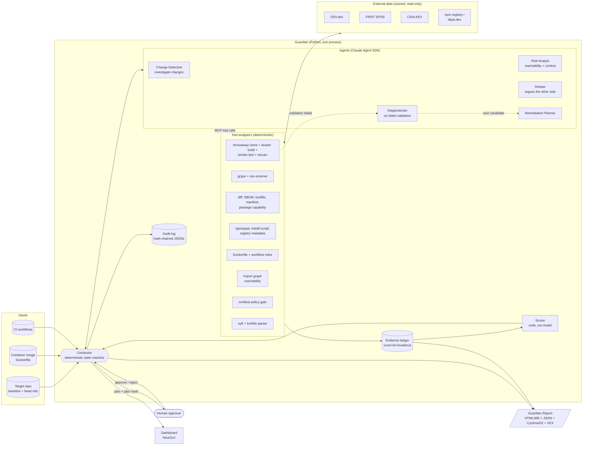

# Guardian — system design

Status: design for a two-day build, followed by what was actually built (section 0). Section 12
lists what is deliberately left out. Build log with measured results: `implementations.md`.

## 0. As built (2026-11-24)

The pipeline, the product rules and the human gate were built as designed. These parts were
built differently; the rest of this document is the original design and is kept for reference.

| Design | As built | Why |
|---|---|---|
| Phases 1–7 inside `guardian/` (ledger, events, conductor, NiceGUI, syft/grype/osv-scanner wrappers) | Day 1 is the stdlib **fast path** `fastpath/build.py` (lockfile SBOM, OSV API, generic rules, HTML dashboard); Day 2 (`guardian/`) reads its outputs into `runs/<id>/` | a 70-minute checkpoint; scanners not installed on the build machine |
| Evidence ledger with per-fact records + command + hash | evidence embedded in each finding (source, line, excerpt; API URL + fetch time); ids `F….E<n>`; agent tool outputs minted as `T<n>` by `guardian/evidence.py`; the report's evidence index carries the sha256 of every excerpt | same rule (only code writes facts), smaller implementation |
| Conductor + event stream + replay | CLI stages: `scan → prioritise → analyse → plan → approve → validate (→ diagnose → plan) → report`; `run.json` records stage status | no replay mode was built |
| Claude Agent SDK, in-process MCP tools | **Gemini REST API** (stdlib client, `guardian/agents/llm.py`) with an allow-list of read-only tools, schema-validated output, turn/token limits, deterministic fallback | the team has a Gemini key, not an Anthropic key |
| conftest + `policy/guardian.rego` | `guardian/policy.py`: the same rules in Python, plus a **plan gate** (no deny left on the plan's target, none introduced) | conftest not installed; the whole-repo gate can never pass while pre-existing KEV/critical findings remain |
| Validation: docker build + smoke test | `npm ci --ignore-scripts`, `node --check`, require resolution, rescan, SBOM diff, new findings, policy; the container build and smoke test are **not implemented** (reported "not run") | docker not installed on the build machine, so they were not built; best verdict is "partial" |
| NiceGUI pages (Overview … Agent trace) | `fastpath/out/guardian.html` (Day 1) and `runs/<id>/report/guardian-report.html` (Day 2) | time |
| Scorecard, hold-outs, second app | not built (the ground-truth comparison was done by hand: 7/7, 3/3) | time |

Package layout as built:

```
fastpath/build.py, template.html          Day 1 pipeline and dashboard
guardian/cli.py                           python -m guardian <scan|prioritise|explain|analyse|plan|approve|
                                                              validate|report|accept|policy|audit-verify|doctor>
guardian/runs.py                          run directories, read-only materialisation of refs
guardian/prioritise.py, scoring.py, reachability.py, cvss.py, enrich.py     phase 8
guardian/evidence.py, env.py, agents/{llm,tools,runner,planner}.py, agents/prompts/*.md   phase 9
guardian/remediate.py, policy.py, audit.py                                 phase 10
guardian/validate.py, loop.py                                             phase 11
guardian/report.py, schemas/guardian-report.schema.json                   phase 12
tests/unit/                                62 tests, no network, no docker
```

## 1. One-paragraph description

Guardian watches one application's software supply chain. Given a git repository and two refs
(a trusted baseline and the current head), it inventories everything the app is built from,
finds known vulnerabilities and suspicious changes, decides which of them matter for *this*
application, proposes the safest fix, waits for a human to approve it, proves the fix in an
isolated build, and writes a report in which every sentence is either backed by reproducible
evidence or openly labelled as AI inference.

## 2. What makes it different (the four things judges should remember)

| # | Idea | Where it shows up |
|---|---|---|
| 1 | **A closed agent loop, shown live.** Plan → human approval → real build and test → the fix fails → an agent diagnoses the failure from the logs → new plan → second approval → verified. | Validation page + Agent trace |
| 2 | **Evidence ledger.** Facts are written only by code from tool output; everything a model says is labelled inference and its cited support is checked. | Two columns on every finding: "Verified facts" / "AI assessment"; evidence drawer |
| 3 | **A scorecard against planted ground truth, with hold-outs.** Harmless planted risks, including seeds the detectors never saw during development; Guardian shows detected / missed / false alarms. | Overview page; `guardian scorecard` |
| 4 | **A refuter agent.** A second agent argues against each high-priority finding and each fix. Its verdict moves confidence by fixed rules. | Finding detail; plan detail |

Supporting ideas: capability diff between package versions, reachability with a file:line
witness exported as VEX, approval bound to a plan hash, and Guardian checking its own toolchain.

## 3. Architecture overview



Approval point: between **plan** and **validate**. AI interactions: only the boxes under
"Agents". Evidence storage: the ledger and audit log under `runs/<run_id>/`.

## 4. Pipeline

| Stage | Deterministic part (always runs) | Agent part (judgement) | Output |
|---|---|---|---|
| 0 preflight | tool versions, target refs exist, cache status | — | `preflight.json` |
| 1 discover | parse manifest + lockfile; SBOM (CycloneDX) for base and head; dependency edges and paths; origin of each component (lockfile `resolved`); Dockerfile and workflow inventory; prod/dev scope; gaps recorded as `NotEvaluated` | — | `Inventory` ×2 |
| 2 detect-vulns | grype + osv-scanner on the head SBOM, merged by advisory alias; fixed versions; dependency path to each vulnerable component; EPSS + KEV enrichment | — | `Finding[type=vulnerability]` |
| 3 detect-changes | SBOM/lockfile/manifest diff base→head; detectors H0–H11 (see research 03): known-malicious, typosquat, unexpected dependency, suspicious update (capability diff), install script, untrusted source, integrity change, image rules, CI rules | **Change Detective** reads each change finding's verified facts, pulls more evidence with tools (open the tarball, read the script, check the registry, look at the commit) and writes the AI assessment: what the change appears to do and which real incident pattern it resembles | `Finding[...]` |
| 4 prioritise | reachability tiers R0–R3 from the import graph; exposure from scope; scorer computes score, range, confidence, guardrails | **Risk Analyst** reads the advisory, finds call sites, judges which function is vulnerable and whether it is reached (INFERRED; cited quotes are checked; the tier is then recomputed by code) | `RiskScore` on each finding |
| 5 refute | fixed rules apply the verdict | **Refuter** argues against the top N findings: wrong version range? not in prod closure? symbol never imported? Verdict upheld / downgraded / refuted / inconclusive. "Refuted" only creates a not-affected *candidate* for a human to confirm | `RefuterVerdict`, confidence adjusted by code |
| 6 plan | enumerate candidate actions per finding; dry-run each (resolve only) to predict resolved findings, added components, semver distance; policy gate (conftest) | **Remediation Planner** ranks candidates, writes rationale, compatibility notes and rollback; Refuter reviews the chosen plan | `RemediationPlan` (state `pending_approval`) |
| 7 approve | state machine; approval record binds approver + plan hash; any plan edit voids the approval | — (humans only) | `Approval` |
| 8 validate | throwaway clone; baseline smoke test first; apply patch; docker build; smoke test; rescan; SBOM diff; new-finding check; policy re-check; compare prediction with outcome | **Diagnostician** runs when a check fails: reads the logs, explains, recommends the next candidate; the conductor creates a superseding plan that needs a fresh approval | `ValidationResult` |
| 9 report | render from the run directory: inventory, paths, findings, ranking, actions, validation, remaining risk, audit trail; exports JSON, CycloneDX, OpenVEX; summary filled by template | — (optional Reporter agent is a stretch item) | `report/` |

Stages 0–3 are Day 1. Stages 4–9 are Day 2. The Day-1 "initial risk level" is the scanner
severity (vulnerabilities) or a fixed rule table (anomalies), clearly marked as initial.

## 5. Agents

All agents are Claude Agent SDK `query()` calls configured the same way:

- `tools=[]` removes every built-in tool (no Bash, no file access, no web); the agent's own
  in-process MCP tools are the only tools, pre-approved with `allowed_tools`, and
  `permission_mode="dontAsk"` denies anything else. (`allowed_tools` alone does not restrict.)
- `setting_sources=[]` so this repo's CLAUDE.md and hooks do not leak into the runtime agents.
- `output_format` JSON schema generated from the pydantic contract; result validated; one retry.
- `max_turns` and `max_budget_usd` set per agent; model set per agent in `guardian.toml`.
- A deterministic fallback result when the call fails, marked "agent step skipped".
- Every tool call and result is emitted as a `StageEvent` (UI stream, replay) and audit event.

| Agent | Tools it may call | Must not do | Default model |
|---|---|---|---|
| Change Detective | read_package_file, capability_profile, capability_diff, registry_metadata, commit_context, find_imports, list_incident_patterns | execute package code; treat package text as instructions; accept a package's self-description as evidence | sonnet |
| Risk Analyst | get_advisory, find_imports, find_call_sites, read_source_excerpt | set the score (code does) | sonnet |
| Refuter | same read-only tools as the two above + get_finding | soften findings without evidence | a different model from the analyst if available (opus) |
| Remediation Planner | list_fix_candidates, dry_run_candidate, policy_check, find_imports | apply anything | sonnet |
| Diagnostician | read_build_log, read_test_log, get_plan, find_imports, list_fix_candidates | approve or apply anything | sonnet |

No agent can write a VERIFIED claim. Agent output is INFERRED; its cited evidence ids and
quotes are checked by `ledger.check_claim` (as built: `guardian/evidence.py::EvidenceIndex.check_claim`).

Why a deterministic conductor instead of one orchestrating super-agent: stage order is fixed by
the brief, an LLM orchestrator adds latency and a failure mode for no gain, and subagent results
come back summarised. Agents are used where the task is open-ended. Say this in the pitch; it is
a strength ("agents where judgement is needed, code where correctness is needed").

Prompt-injection stance: text from packages and advisories is passed inside clearly delimited
data blocks, tools return capped excerpts, agents cannot write or execute, a package's
description of itself is never evidence, and because only code writes facts a model cannot
"verify" anything. As built, one adversarial unit test covers a paraphrased and one a verbatim self-description
(`tests/unit/test_agents.py`); no live adversarial run against a model has been done.

## 6. Risk score

Full derivation and worked examples: `docs/research/04-prioritise-remediate-validate-stretch.md`
sections 1.5–1.7. Summary:

`score = round(100 × Σ weight_i × value_i / 100)`, then guardrails.

| Factor | Weight | 0..1 value | Prior if unknown |
|---|---|---|---|
| severity | 30 | CVSS base / 10 (or GHSA bucket) | 0.6 |
| exploitability | 25 | KEV 1.0; EPSS ≥0.5 → 0.9; ≥0.1 → 0.7; ≥0.01 → 0.4; else 0.15 | 0.4 |
| reachability | 20 | R0 not imported 0.1; R1 imported 0.5; R2 vulnerable symbol referenced 0.8; R3 on a request path with untrusted input 1.0 | 0.5 |
| exposure | 15 | prod + internet-facing 1.0; prod internal 0.6; dev/build only 0.3 | 0.6 |
| fix availability | 10 | fix in same major 1.0; major bump 0.7; none 0.5 | 0.6 |

Guardrails (reported whenever they fire): `KEV_FLOOR` (KEV and R≥1 or unknown → at least 90);
`NOT_LOADED_CAP` (R0 verified/heuristic and not KEV → at most 39); `MALICIOUS_FLOOR`
(known-malicious advisory, or a new component from an untrusted origin with an install script
that shows two or more red-flag capabilities → at least 90).

Confidence (0–100) is separate: it starts from the share of weight backed by verified/heuristic
factors, is reduced for each unknown, and is adjusted by the refuter verdict (upheld +, refuted −).
The score is always shown with its range (best case / worst case for the unknown factors).

Non-CVE anomalies use the same five factor names with a rule table for severity and
exploitability (research 04 §1.7), so one ranked list can mix CVEs and anomalies.

Bands: critical ≥ 85, high 65–84, medium 40–64, low 15–39, info < 15.

### Implemented rubric (phase 8, `guardian/prioritise.py`)

Non-CVE anomalies, one row per finding type. Rows marked * extend research 04 §1.7.

| Type | Severity | Exploitability (hostile-signal strength) | Reachability | Exposure |
|---|---|---|---|---|
| look-alike name (`typosquat`) | .85 | edit distance 1 and new → .8, else .5 | install script → 1.0; imported → .8; lockfile only → .4 | install script → 1.0; else prod/dev as for CVEs |
| unsafe install script | .7 | URL or network signal → .8; other signals → .6; none → .5 | as above | as above |
| suspicious update | .7 | install hook added → .8; size jump only → .6 | as above | as above |
| non-registry origin* | .6 | .3 | as above | as above |
| unexpected dependency* | .5 | .3 | as above | as above |
| unsafe CI pattern* | .7 | `curl \| sh` → .6; `write-all` only → .3 | workflow with write permissions or secrets → 1.0, else .5 | 1.0 (runner holds credentials) |
| unpinned CI component | .5 | action advisory in KEV → 1.0 (verified); OSV advisory → .8; none → .3 | as above | 1.0 |
| untrusted image | .4 | .3 | 1.0 (base of the runtime) | prod |
| lockfile drift | .35 | .3 | — | — |
| new / changed dependency* | .2 | .15 | as for packages | as for packages |

Fix availability is 1.0 (remove, replace or pin) for every anomaly. Grades: rubric constants are
`heuristic`; facts read from the lockfile (install script) are `verified`.

## 7. Data contracts

`guardian/contracts.py` (pydantic v2) holds the objects that cross stage boundaries: `Evidence`,
`Claim`, `NotEvaluated`, `Component`, `Inventory`, `Finding`, `Investigation`, `Factor`,
`RiskScore`, `RefuterVerdict`, `FixCandidate`, `RemediationPlan`, `Approval`, `Check`,
`ValidationResult`, `AuditEvent`, `StageEvent`. It is starter code: extend it as phases need.
Agent output schemas are separate, small, flat models (the SDK validates draft-07 JSON Schema).

Git refs are scanned from `git archive <ref>` extracted into `runs/<id>/src/<ref>/`; fixes are
tried in `git clone --local` copies under `runs/<id>/work/`. `./target` is never written to.

Run directory:

```
runs/<run_id>/
  run.json                 target, refs, commits, mode, tool versions, model names, timings
  evidence/E-0001.json     raw tool/API output  (+ index.jsonl of Evidence records)
  sbom.base.cdx.json  sbom.head.cdx.json  sbom.after.cdx.json
  inventory.base.json  inventory.head.json
  changes.json             component + file level diff
  findings.json            all findings with claims, risk, refuter verdict
  src/<ref>/               source of each scanned ref (git archive)
  work/<plan>/             throwaway clone where a fix is applied and built
  plans/P-0001.json        approvals/P-0001.json     validation/P-0001.json
  events.jsonl             StageEvent stream (drives the UI and replay mode)
  audit.jsonl              hash-chained AuditEvent log
  report/guardian-report.html|.md  guardian-report.json  vex.openvex.json
  scorecard.json
```

## 8. Package layout

```
guardian/
  contracts.py         data models (shipped)
  config.py            guardian.toml: models, weights, trusted registries, allow-lists
  ledger.py            Evidence store, quote check, redaction
  audit.py             hash-chained log + verify
  events.py            StageEvent bus (asyncio queue + JSONL) and replay
  runctx.py            RunContext: paths, mode, caches
  conductor.py         stage state machine
  cli.py               Typer CLI
  tools/               one module per wrapper: sbom, lockfile, vulns, enrich, diff,
                       capability, typosquat, registry, dockerfile, workflows, reachability,
                       policy, remediate, validate, provenance, gitutil, proc (safe subprocess)
  detectors/           H0..H11 rule functions -> raw signals
  scoring.py           factors, guardrails, confidence, bands
  agents/              base.py (SDK wrapper), one module per agent, prompts/*.md, mcp.py
  report/              render.py, templates/, vex.py
  data/                popular_npm_names.txt, incident patterns
  scorecard.py         compare run to demo/ground_truth.yaml
  ui/                  app.py, pages/, components/ (NiceGUI)
tests/                 unit/ (fixtures, no network), e2e/ (marked), ui/
policy/                Rego rules + conftest tests
```

## 9. UI (NiceGUI, one FastAPI process; fallback Streamlit — see research 06 §3)

Pages, in demo order: **Overview** (funnel "N components → M findings → K that matter",
scorecard, run status) · **Inventory** (table + dependency tree/graph, origin column) ·
**Changes** (baseline → head: added/removed/changed components and files, each linked to its
commit) · **Findings** (ranked list; detail panel with dependency path, claim chips, evidence
drawer, score breakdown with range and confidence, refuter verdict) · **Remediation** (candidate
comparison, chosen plan, policy result, diff, Approve / Reject with name) · **Validation**
(stepper: baseline test → apply → build → test → rescan → SBOM diff; before/after; on failure
the diagnosis and the superseding plan) · **Report** (rendered report + downloads) · **Agent
trace** (live timeline of agent and tool events; shown on the projector during the loop).

Rules: findings show two columns, "Verified facts" and "AI assessment"; verified = solid chip,
derived = outlined, inferred = dashed with an "AI" tag; unknown is grey and says "unknown";
replay mode shows a permanent "REPLAY" badge; all JS/CSS is local.

## 10. Safety and Responsible AI controls (implemented, not just documented)

| Control | Mechanism |
|---|---|
| Hallucination control | facts written only by code from tool output; agent output always labelled inference with checked support; schema-validated outputs; scores, policy and pass/fail computed in code; refuter agent |
| Human approval | plan state machine; approval record with approver + plan hash; validation refuses unapproved or changed plans; a superseding plan needs a new approval; not-affected and accepted-risk need a named human; nothing is ever pushed, merged or opened as a pull request |
| Least privilege for agents | per-agent allow-list of read-only tools built by our code; an unknown tool name is refused; no shell, write or network tool exists; turn, token and timeout limits; schema-validated output |
| Untrusted content | package/advisory text handled as data; static analysis only; as built, install scripts never run: `npm` always runs with `--ignore-scripts` (the validation container was not built) |
| Secrets | only the model key (`GEMINI_API_KEY`), loaded from `.env` at runtime, never printed; sent only in the `x-goog-api-key` header; `redact()` on every string sent to a model and on tool outputs; no secrets in `runs/` |
| Source code protection | only excerpts (not whole files) go to the model; documented in the Responsible AI note with the list of data that leaves the machine |
| Auditability | hash-chained audit log; `python -m guardian audit-verify` |
| Honesty | unknown never shown as clean (OSV/EPSS/KEV/agents report "not evaluated" / "skipped"); the automatic scorecard and hold-out seeds were **not built** (ground truth checked by hand) |

## 11. Performance targets

**Measured (README, implementations.md):** scan ~20 s; plan 21–35 s per candidate; validation ~3 min
(`npm ci` alone 141 s), so the 2-minute validation target is not met. The targets below are the design.


Discover + detect under 60 s on the demo target with warm caches; scanners run concurrently
(`asyncio.gather`); advisory lookups cached; agents for independent findings run concurrently
with a small semaphore; images pre-pulled. Validation (docker build + smoke test) under 2
minutes warm. Replay mode re-emits `events.jsonl` at 5–10× speed. Measure, then put the real
numbers in the README.

## 12. Deliberately out of scope for the two days

Multi-ecosystem support beyond npm (design allows it; say so), full call-graph analysis,
dynamic sandboxing of packages, opening pull requests anywhere (a patch and PR text are written
to disk instead), deployment, auth and multi-user support, SARIF export, long-running
monitoring (shown as a replayed advisory timeline instead).
