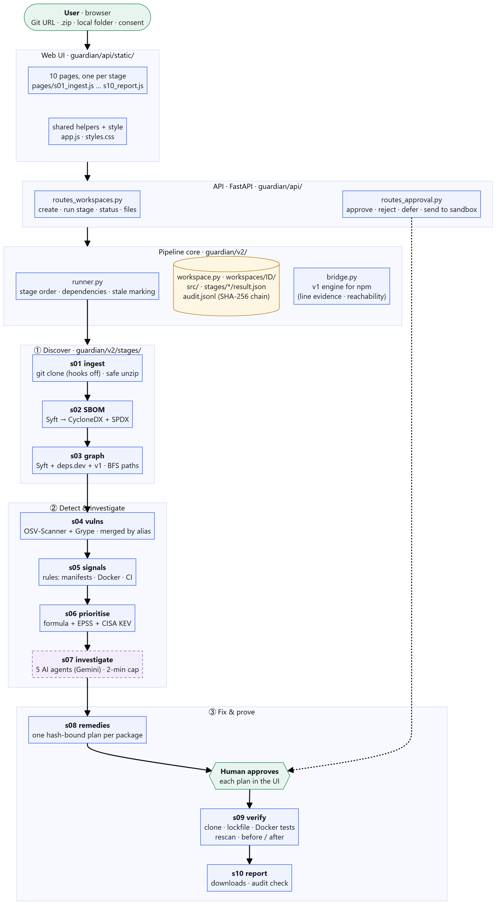

# Guardian v2: architecture and approach

Guardian v2 analyses **any repository** (npm, pip, Go, Maven/Gradle, Cargo, Ruby, PHP, .NET) in a
web UI, one stage at a time:
- an SBOM, then a dependency graph with evidence;
- vulnerabilities from two scanners, then supply-chain signals;
- a prioritised risk report, then an AI investigation;
- remedies, each approved by a human;
- a sandbox proof, then a report.

Start it with `python -m guardian ui` and open http://127.0.0.1:8080.



Diagram source: [`architecture_v2.mmd`](architecture_v2.mmd). GitHub draws Mermaid, so the source
can also be pasted into any Markdown file.

---

## 1. The approach in six rules

1. **Tools first, our code second.** Standard tools do the heavy lifting: Syft (SBOM), OSV-Scanner
   and Grype (vulnerabilities), deps.dev (dependency trees), EPSS and CISA KEV (exploit data). Our
   code merges, cross-checks, scores and explains.
2. **Code decides, AI explains.** Scores, verdicts, plans and pass/fail are computed by
   deterministic code. The AI agents only investigate, explain and challenge. Their claims are
   labelled *inferred*, and every quote is checked word for word against the evidence.
3. **A human approves every fix.** Approval is a click in the UI, bound to the plan's SHA-256 hash
   and written to a hash-chained audit log. No agent and no stage can approve.
4. **Nothing from the repository runs on the host.** Clones run with git hooks off, `npm` runs
   with `--ignore-scripts`, and nothing is installed or built. The repository's tests run only in
   stage 9, inside Docker with `--network none`.
5. **Unknown is never zero.** A tool that did not run shows **not run**, never "0 found". An unknown
   scoring factor lowers confidence instead of lowering the score.
6. **Everything is a file.** Each stage writes `workspaces/<id>/stages/<stage>/result.json`. Every
   page ends with "Source files" links to the exact files behind its numbers.

---

## 2. The 10 stages: what, how, where

Each stage is one backend file (`guardian/v2/stages/sNN_<name>.py`, function `run_<name>`) and one
page (`guardian/api/static/pages/sNN_<name>.js`) with the same number and name.

| # | Stage (page) | What it does | Built with | Output |
|---|---|---|---|---|
| 1 | Start & intake | Fetches the repo (git URL, zip or folder) and detects every ecosystem, Dockerfile and CI workflow; records consent | git (`--depth 50`, hooks off, size cap), safe unzip | `stages/ingest/result.json` |
| 2 | Inventory & SBOM | Lists every package; direct/transitive and dev from the manifests; cross-checks npm against the v1 parser | **Syft 1.57.2** → CycloneDX + SPDX | `stages/sbom/` |
| 3 | Dependency graph | Who pulls in what, with evidence for every edge; depth, paths, fan-in | Syft relationships, v1 lockfile lines, **deps.dev** API, BFS | `stages/graph/result.json` |
| 4 | Vulnerabilities | Finds advisories, merged across tools by alias (CVE/GHSA/PYSEC); tool agreement; EPSS and KEV | **OSV-Scanner 2.7.1**, **Grype 0.122.1**, v1 OSV (npm), FIRST EPSS, CISA KEV | `stages/vulns/` |
| 5 | Supply-chain signals | Risks with no CVE: unpinned versions, URL/VCS sources, custom index, floating images, `curl \| sh`, unpinned actions, write-all tokens | Rules over files (+ v1 rules for npm) | `stages/signals/result.json` |
| 6 | Prioritised risk | `30·severity + 25·exploitability + 20·reachability + 15·exposure + 10·fix`, guardrails, confidence and range, code-written reasons | v1 scoring (npm, with reachability) + an adapter for every ecosystem | `stages/prioritise/result.json` |
| 7 | Agent investigation | AI agents investigate the top items under a **2-minute** budget; a slow key rotates to the next | Gemini API, own client, quote checker, JSON schema | `stages/investigate/result.json` |
| 8 | Remedies (approval) | One plan per package: the lowest version that fixes all its advisories; patch, `plan_hash`, rollback; waits for a human | git (throwaway clone), SHA-256 | `stages/remedies/` |
| 9 | Sandbox verification | Applies the approved edits to a fresh clone, refreshes the lockfile, runs tests in Docker, rescans, compares before/after; verdict | git, npm `--package-lock-only --ignore-scripts`, Docker, Syft, Grype, OSV-Scanner | `stages/verify/` |
| 10 | Report | Stage coverage, top risks, plans, verdict, audit-chain check, downloads | own code | `stages/report/` |

**Stage dependencies** (`guardian/v2/runner.py`):
- sbom ← ingest;
- graph, vulns and signals ← sbom;
- prioritise ← vulns + signals + graph;
- investigate and remedies ← prioritise;
- verify ← remedies (after "Send to sandbox");
- report ← whatever has run.

Re-running a stage marks every later stage **stale**.

**Verify verdicts:**
- **VERIFIED:** every check passed, including the tests in Docker.
- **PARTIAL:** nothing failed, but something did not run or passed only with a warning.
- **FAILED:** any check failed.

---

## 3. The AI agents (5)

Shown on the *Agent investigation* page, with a count tile, an overview table and one tab per
agent.

| Agent | When | What it produces | What code does with it |
|---|---|---|---|
| Change Detective | Suspicious changes | What the change does and what attack it resembles | Shown only; never changes the score |
| Risk Analyst | Top vulnerabilities | Vulnerable function (quoted) and whether the app calls it | A reachability change applies only if a call site exists |
| Refuter | Top findings, and plans | upheld / downgraded / refuted / inconclusive | Fixed rules: upheld → confidence +5; downgraded → a grade drops; refuted → a "not affected" *candidate* for a human |
| Remediation Planner | Plans (v1 engine) | Rationale, risks, preferred candidate | Advisory; code chooses |
| Diagnostician | A failed validation (v1 engine) | Root cause, next candidate | Accepted only if it names an eligible candidate |

How they work together:
- Agents never talk to each other. Guardian's code calls each one with a task built from the
  evidence, gives it read-only tools, validates its JSON, drops any quote that is not literally in
  the evidence, and writes the result to a file.
- In v2, agents run on the npm deep layer. Other ecosystems show "skipped" with the reason.
- **Time budget:** 115 s for the whole stage and at most 30 s per call, with 4 calls in parallel.
  On a timeout or a 5xx error, the client switches to the next key in `GEMINI_API_KEY_1..9`.
  Unfinished items show "skipped: time budget used up".

---

## 4. Code map: where to find what

```
guardian/
  cli.py                       commands: ui · ws create|status|list · stage <name> --ws <id> [--until]
  api/
    app.py                     FastAPI app: mounts the two routers and the static UI
    routes_workspaces.py       POST /api/ws, /api/ws/upload · GET /api/ws/{id} · run a stage / run until · files
    routes_approval.py         POST /api/ws/{id}/plans/{plan}/decision · /remedies/send-to-sandbox (the human gate)
    static/
      index.html               page shell: top bar, left navigation, page area
      app.js                   shared helpers (G.*): api, header, tiles, table, tabs, badges, chips, sources
      styles.css               the one stylesheet (light and dark)
      pages/s01_ingest.js … s10_report.js     one page per stage
  v2/
    workspace.py               Workspace: workspaces/<id>/ (workspace.json, src/, stages/, audit.jsonl)
    runner.py                  stage registry, order, dependencies, stale marking, run_until
    bridge.py                  runs the v1 engine on a workspace (npm deep layer)
    tools.py                   find_tool / tool_version (tools/bin first, then PATH)
    proc.py                    run() for subprocesses, offline(), now()
    identity.py                norm_name, norm_version, purl_type, norm_purl, vkey (shared by all stages)
    stages/
      s01_ingest.py            check_git_url, _safe_unzip, detect, run_ingest
      s02_sbom.py              run_syft, direct_deps, components_from_syft, run_sbom
      s03_graph.py             depsdev_resolve, _paths (BFS), run_graph
      s04_vulns.py             records_from_osv_scanner / _grype / _v1, merge, run_vulns
      s05_signals.py           repo_signals, manifest_signals, run_signals
      s06_prioritise.py        _generic_vuln_factors, why_text, vs_next_text, initial_vs_final, run_prioritise
      s07_investigate.py       run_investigate (2-minute budget)
      s08_remedies.py          plan_hash, apply_edit, run_remedies, record_decision, freeze_approved
      s09_verify.py            test_plan, docker_cmd, container_tests, run_verify
      s10_report.py            run_report
  agents/                      v1 agents: llm.py (Gemini client, key rotation, deadline), runner.py, tools.py, prompts/
  prioritise.py, scoring.py, reachability.py, enrich.py, remediate.py, validate.py, …   v1 engine (reused)
fastpath/build.py              v1 day-1 engine (npm lockfile → SBOM, graph, OSV, sabotage rules)
scripts/setup_tools.py         downloads Syft / OSV-Scanner / Grype into tools/bin and checks SHA-256
tests/unit/test_v2_core.py     workspace, allow-list, zip safety, runner, file endpoint, API
tests/unit/test_v2_detect.py   tool merge, not-run handling, explanations, agent time budget
tests/unit/test_v2_fix.py      plans, hash binding, approvals only via HTTP, verify verdicts, Docker isolation
docs/planning/                 the plans and team prompts used to build v2 (historical)
```

**Workspace layout** (one per analysis, git-ignored):

```
workspaces/<id>/
  workspace.json               source, ref, sha, consent, v1_run, per-stage status/summary/timing
  src/                         the repository snapshot (read-only for Guardian)
  stages/<stage>/result.json   what each page renders (+ raw tool outputs, patches, logs)
  v1runs/, v1out/              v1 engine outputs (npm repos only)
  work/plan, work/verify       throwaway clones for patches and the sandbox
  audit.jsonl                  consent, stage runs, decisions, verdicts (SHA-256 hash chain)
```

---

## 5. Run it

```powershell
python scripts/setup_tools.py            # once: Syft, OSV-Scanner, Grype into tools\bin (SHA-256 checked)
python -m guardian doctor                # tools, keys
python -m guardian ui                    # http://127.0.0.1:8080 → "+ New analysis"

# the same without the UI
python -m guardian ws create --kind git --value https://github.com/anxolerd/dvpwa --ref 5ee2dc2 --by "Your Name"
python -m guardian stage remedies --ws <id> --until    # runs stages 1–8
python -m guardian ws status --id <id>

python -m pytest -q --basetemp=E:/pytest-tmp           # 99 unit tests (use any drive with free space)
```

Configuration (`guardian.toml`):
- `[sources] allow = ["*"]`: any https repository (consent is still required). To restrict, list
  `host/owner` entries instead.
- `[score]`: weights, priors and bands.
- `[agents.gemini]`: models.
- `[run] agent_concurrency`: parallel agent calls.

Gemini keys go in `.env` as `GEMINI_API_KEY_1`, `GEMINI_API_KEY_2`, and so on. Only the count is
ever shown.

---

## 6. Known limitations (honest)

- **Docker is required for "tests pass".** Without it, the tests are *not run* and the best verdict
  is PARTIAL.
- **Reachability is npm-only.** Other ecosystems score reachability as *unknown*, which lowers
  confidence.
- **Agents in v2 cover the npm deep layer only.** Other ecosystems show "skipped".
- **Plans pick the lowest fixed version.** A major upgrade is flagged as a breaking risk. If npm
  reports a peer-dependency conflict, the lockfile is resolved with `--legacy-peer-deps` and marked
  *warning*. Advisories on the target version itself are caught by the sandbox rescan as "new".
- **Unpinned requirements** (e.g. `flask>=2`) cannot be matched to advisories; they are listed as
  such.
- **deps.dev-resolved edges** show what a resolver would choose today; a real install can differ.
  They are labelled.
